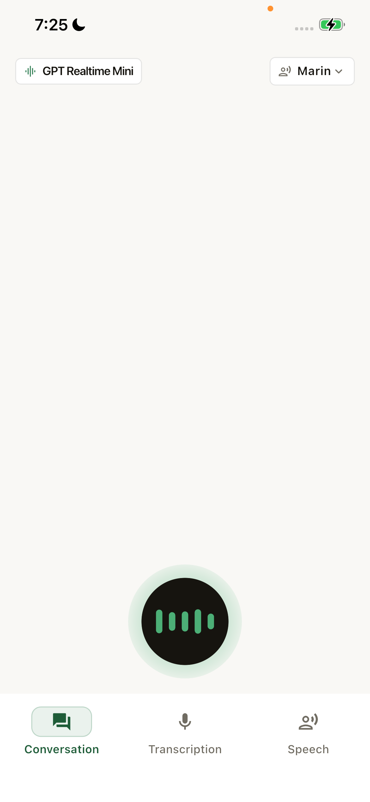
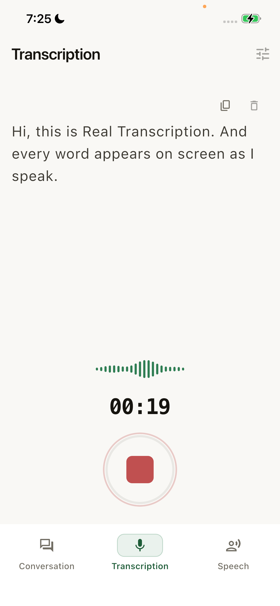
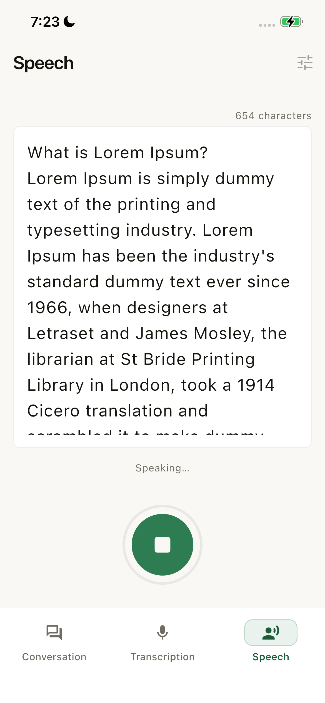

<div align="center">


# Wiro Realtime for Flutter: Voice AI Example for Android and iOS

Realtime voice AI for Android and iOS in Flutter and Dart: live conversation, speech-to-text and text-to-speech with the Wiro AI API.

[](#requirements) [](https://dart.dev) [](https://github.com/wiroai/Dart-Realtime/actions/workflows/ci.yml) [](LICENSE)

[Website](https://wiro.ai) · [Models](https://wiro.ai/models) · [Docs](https://wiro.ai/docs/realtime-voice-conversation) · [Dashboard](https://wiro.ai/panel)

</div>

Wiro Realtime for Flutter is the official open-source example for
building realtime voice AI into Android and iOS apps with Flutter, Dart
and the Wiro AI API. Its three tabs stream audio over WebSocket for a
live speech-to-speech conversation with barge-in, live speech-to-text
from the microphone, and text-to-speech playback. The `core/` layer
(auth, network, realtime, audio) has no dependency on any feature, so
you can lift it into your own app.

<p align="center">
  
  
  
</p>

## What's inside

Three realtime audio flows, each a tab in the app, each backed by a live
Wiro AI model over one WebSocket protocol:

| Flow | Model | What it does |
| --- | --- | --- |
| Conversation | [`openai/gpt-realtime-mini`](https://wiro.ai/models/openai/gpt-realtime-mini) | Full-duplex voice chat with barge-in |
| Transcription | [`mistralai/voxtral-mini-4b-realtime-2602`](https://wiro.ai/models/mistralai/voxtral-mini-4b-realtime-2602) | Live speech-to-text as you talk |
| Speech | [`openmoss/moss-tts-realtime`](https://wiro.ai/models/openmoss/moss-tts-realtime) or [`openbmb/voxcpm2`](https://wiro.ai/models/openbmb/voxcpm2) | Streaming text-to-speech playback |

## Features

- Live speech-to-speech conversation with voice activity detection,
  barge-in, and a noise gate
- Realtime microphone transcription with streaming partial results
- Streaming text-to-speech with bounded PCM playback
- One native audio graph for capture and playback, so the OS echo
  canceller (AEC) actually works (see
  [`packages/wiro_voice_engine`](packages/wiro_voice_engine))
- Signed REST Run requests and the full Wiro AI realtime WebSocket
  protocol
- Bounded capture/playback queues, safe PCM overflow shedding, audio
  route and interruption handling
- Cross-feature guard so two tabs never hold the microphone at once
- Automatic reconnect to the same task on socket drops, with a bounded
  restart budget
- Session lifecycle fully covered by tests, so no device is needed to
  verify the plumbing

## Requirements

- Flutter stable with Dart `3.13.1` or newer
- A **physical** Android or iOS device (simulators have no usable
  microphone path)
- A [Wiro AI project and API key](https://wiro.ai/panel/project/new)

The iOS project uses Swift Package Manager: there is no Podfile and no
CocoaPods setup to run. Use a Flutter version with SPM support enabled.
The project ships without a signing team: open `ios/Runner.xcworkspace`
once and pick yours under **Runner → Signing & Capabilities** before the
first device run.

## Run

```sh
flutter pub get
flutter run --dart-define=WIRO_API_KEY=YOUR_API_KEY
```

For signature-based Wiro AI projects, also pass the secret:

```sh
flutter run \
  --dart-define=WIRO_API_KEY=YOUR_API_KEY \
  --dart-define=WIRO_API_SECRET=YOUR_API_SECRET
```

Leave `WIRO_API_SECRET` out for API-key-only projects. The app fails
before `runApp` when `WIRO_API_KEY` is missing.

> **Credentials warning:** values supplied through `--dart-define` are
> compiled into the binary and are for local development only. Never
> distribute builds containing real credentials: production apps should
> authenticate through a controlled backend or a short-lived credential
> flow.

## Make it yours

[`lib/app/config/conversation_config.dart`](lib/app/config/conversation_config.dart)
holds the persona, the voice, the model, and the session time limit.
Editing that one file is the whole of turning this example into a
product.

```dart
static const String persona = '...who the assistant is...';
static const String voice = 'marin';
static const Duration maxSessionDuration = Duration(minutes: 10);
```

Common changes:

- **Give the assistant a job**: rewrite `persona`.
- **Change the voice**: set `voice` to any option the model catalog
  lists.
- **Tune the engineering parameters**: `parameters` overrides the
  catalog defaults for turn detection, audio formats, and rates.
- **Ship only the conversation**: delete
  `lib/features/speech_to_text/` and `lib/features/text_to_speech/`
  (plus their `test/features/` folders), then remove the two
  `NavigationDestination`s from
  `lib/features/realtime_home/view/realtime_home_view.dart`. `core/` is
  untouched.

## How a conversation runs

```text
REST:      https://api.wiro.ai/v1
WebSocket: wss://socket.wiro.ai/v1
Run:       POST /Run/{owner}/{model}
```

1. `POST /Run/{owner}/{model}` returns a task id and a task token.
2. A WebSocket opens and subscribes with
   `{ "type": "task_info", "tasktoken": "..." }`.
3. After `task_stream_ready`, 20 ms PCM chunks stream up as
   `UTF8(tasktoken + "|") + pcm_bytes`; audio and transcripts stream
   back.
4. `task_session_end` closes the session. The app sends it on leave
   or when `maxSessionDuration` runs out.

Audio is signed 16-bit PCM, 24 kHz, mono, little-endian on both sides.

Authentication is `x-api-key` alone, or `x-api-key` + `x-nonce` +
`x-signature` where the signature is
`HMAC-SHA256(key = API_KEY, message = API_SECRET + NONCE)`.

## Project layout

```text
lib/
 app/       shell, theme, layout tokens, config, shared widgets
 core/      reusable Wiro AI plumbing: auth, network, realtime, audio
 features/  one folder per tab: view/, view_model/, service/
packages/
 wiro_voice_engine/  native AEC audio bridge (AVAudioEngine / AudioRecord)
```

`core/` has no dependency on any feature and covers the whole Wiro AI
integration, so it is the part worth lifting into your own app.

## Tests

```sh
flutter analyze
flutter test
```

Tests mirror `lib/` and ship fakes for audio, network, and the socket,
so the entire session lifecycle runs without a device. CI runs the same
two commands, plus `flutter analyze` for `packages/wiro_voice_engine`,
on pushes to `main` and on pull requests.

## Contributing

Read [`CONTRIBUTING.md`](CONTRIBUTING.md) before opening a pull request.
To report a security problem, follow [`SECURITY.md`](SECURITY.md)
instead of opening a public issue.

## Documentation

- [Realtime voice guide](https://wiro.ai/docs/realtime-voice-conversation)
- [Wiro AI documentation](https://wiro.ai/docs)
- [Available models](https://wiro.ai/models)
- Same example on other platforms:
  [Swift](https://github.com/wiroai/Swift-Realtime) ·
  [Kotlin](https://github.com/wiroai/Kotlin-Realtime) ·
  [React Native](https://github.com/wiroai/ReactNative-Realtime)
- [Dart-QuickStart](https://github.com/wiroai/Dart-QuickStart):
  Wiro AI SDK for Dart and Flutter, published as [`wiro` on pub.dev](https://pub.dev/packages/wiro)

## More from Wiro AI

| Repository | What it is |
| --- | --- |
| [Wiro-MCP](https://github.com/wiroai/Wiro-MCP) | Official MCP server for Wiro AI, [`@wiro-ai/wiro-mcp` on npm](https://www.npmjs.com/package/@wiro-ai/wiro-mcp) |
| [Wiro-Plugin](https://github.com/wiroai/Wiro-Plugin) | Wiro AI plugin for Cursor, Claude Code, Gemini CLI and Devin |
| [Swift-QuickStart](https://github.com/wiroai/Swift-QuickStart) | WiroKit, the Wiro AI SDK for iOS |
| [Kotlin-QuickStart](https://github.com/wiroai/Kotlin-QuickStart) | WiroKit, the Wiro AI SDK for Android |
| [Dart-QuickStart](https://github.com/wiroai/Dart-QuickStart) | Wiro AI SDK for Dart and Flutter, [`wiro` on pub.dev](https://pub.dev/packages/wiro) |
| [ReactNative-QuickStart](https://github.com/wiroai/ReactNative-QuickStart) | Wiro AI SDK for React Native and Expo, [`@wiro-ai/wiro-react-native` on npm](https://www.npmjs.com/package/@wiro-ai/wiro-react-native) |
| [Swift-Realtime](https://github.com/wiroai/Swift-Realtime) | Realtime voice AI example for iOS |
| [Kotlin-Realtime](https://github.com/wiroai/Kotlin-Realtime) | Realtime voice AI example for Android |
| [ReactNative-Realtime](https://github.com/wiroai/ReactNative-Realtime) | Realtime voice AI example for React Native |
| [n8n-nodes-wiroai](https://github.com/wiroai/n8n-nodes-wiroai) | Wiro AI nodes for n8n, [`@wiro-ai/n8n-nodes-wiroai` on npm](https://www.npmjs.com/package/@wiro-ai/n8n-nodes-wiroai) |
| [Wiro-Docs](https://github.com/wiroai/Wiro-Docs) | Source of the Wiro AI API docs |

[Website](https://wiro.ai) · [Models](https://wiro.ai/models) · [Docs](https://wiro.ai/docs) · [X](https://x.com/wiroai)

## License

[MIT](LICENSE)

---

<div align="center">


**Built by the Wiro AI team**

[wiro.ai](https://wiro.ai) · [GitHub @wiroai](https://github.com/wiroai)

</div>
